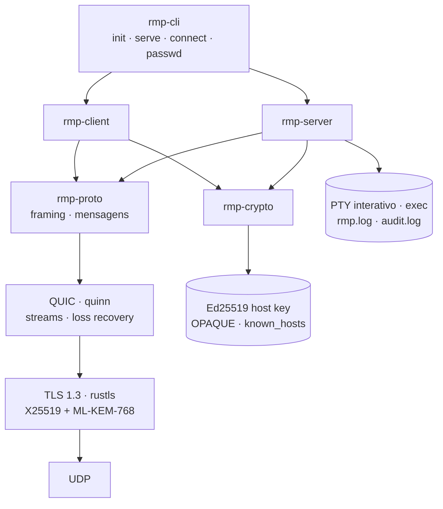
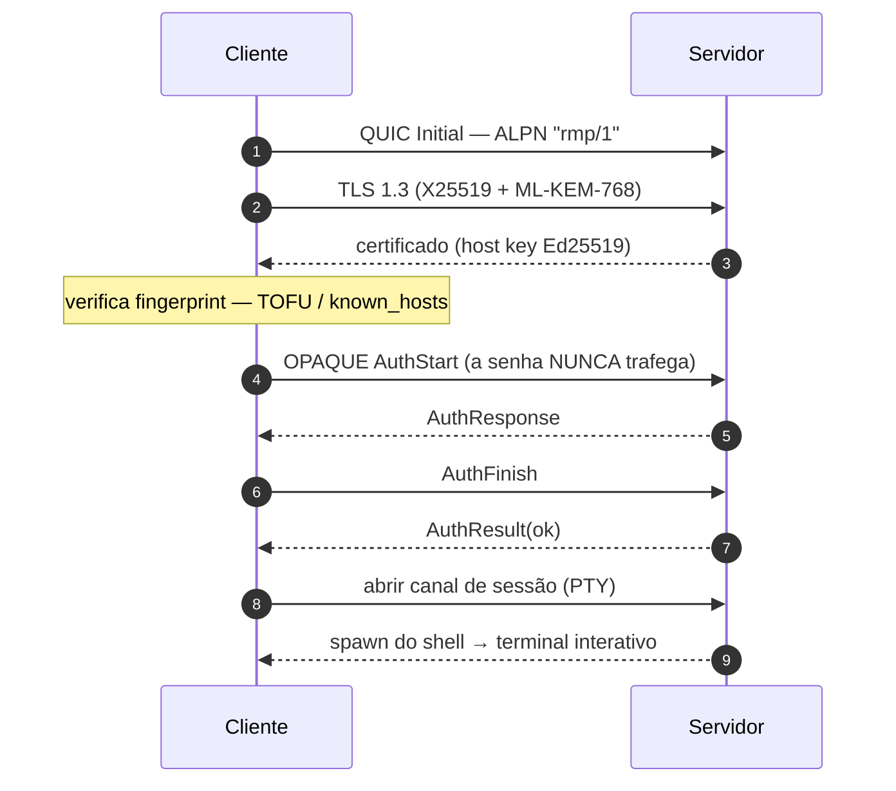

# RMP — Remote Machine Protocol

[](https://github.com/marcosgabrielgomes110-collab/rmp/actions/workflows/ci.yml)
[](https://github.com/marcosgabrielgomes110-collab/rmp/actions/workflows/audit.yml)
[](LICENSE)
[](rust-toolchain.toml)

**RMP** é um protocolo de acesso remoto por terminal — no estilo SSH — construído do
zero sobre **QUIC + TLS 1.3**. Você recebe um shell interativo (PTY) na máquina remota,
com segurança ligada por padrão, boa performance em redes ruins e configuração trivial.

> RMP **não usa SSH**: não faz túnel por SSH, não fala SSH2 e não depende do `sshd`. Ele
> reimplementa tudo numa base moderna.

## Propósito

- **Seguro por padrão** — nenhum texto claro na rede, autenticação resistente a ataques
  e verificação explícita da identidade do servidor.
- **Rápido e robusto** — multiplexação de streams, sem *head-of-line blocking*, e
  recuperação de perda de pacotes/congestionamento delegada ao QUIC.
- **Fácil de usar** — o setup pede uma senha; conectar é `rmp connect user@host`.
- **Multiplataforma** — Linux, macOS e Windows (servidor e cliente).

## Arquitetura



**Estabelecimento de conexão**



> Alternativa ao OPAQUE depois do 1º acesso: **chave de dispositivo**. O cliente envia
> `KeyAuthRequest`, o servidor responde `KeyAuthChallenge` (nonce) e o cliente prova posse
> com `KeyAuthProof` (assinatura Ed25519 sobre usuário+chave+nonce).

| Crate | Responsabilidade |
|---|---|
| `rmp-proto` | Wire protocol: framing, mensagens, codecs |
| `rmp-dirs` | Layout de arquivos (XDG / FHS) |
| `rmp-crypto` | TLS 1.3 + PQC, host keys, OPAQUE, `known_hosts` |
| `rmp-server` | Listener QUIC, autenticação, sessões PTY/exec, audit log |
| `rmp-client` | Transporte, autenticação, cliente interativo/exec |
| `rmp-cli` | O binário `rmp` |

## Segurança

| Proteção | Mecanismo |
|---|---|
| Confidencialidade/integridade | TLS 1.3 obrigatório, AEAD em cada pacote, sem downgrade |
| Forward secrecy | Chaves efêmeras por conexão |
| Resistência pós-quântica | Key exchange híbrido **X25519 + ML-KEM-768** (padrão) |
| Anti-MITM | Pinning de **fingerprint** (Ed25519, TOFU/`known_hosts`) |
| Senha nunca exposta | **OPAQUE (RFC 9807)**; servidor guarda registro resistente a ataque offline |
| Login sem senha | **Chave de dispositivo Ed25519**; o servidor assina/verifica um nonce (sem replay) |
| Port forwarding | Túneis `-L` e `-R` sobre streams QUIC (gates `[server] allow_local_forward` / `allow_remote_forward`) |
| Anti-brute-force | Rate limit + lockout por IP |
| Controle de acesso | Allow/deny por **CIDR** |
| Segredos em disco | Diretórios `0700`, arquivos `0600`, `zeroize` em memória |
| Auditoria | `audit.log` dedicado; comandos podem ser redigidos |
| Modo root | Fail-closed; rebaixa privilégio (`runuser`) para logins comuns |

Garantias, **não-garantias** e adversários em [`docs/threat-model.md`](docs/threat-model.md).

## Início rápido

```sh
# 1. No servidor: gera identidade e pede a senha de acesso
rmp init --user alice
#   config  ~/.config/rmp/config.toml
#   dados   ~/.local/share/rmp/{host_key.pem,opaque_setup.bin,password_file.bin}
#   estado  ~/.local/state/rmp/{rmp.log,audit.log}

# 2. No servidor: sobe o daemon
rmp serve

# 3. De outra máquina: conecta e abre o shell
rmp connect alice@host:2222
#   na 1ª vez mostra a fingerprint e pede confirmação (TOFU), depois a senha
```

**IPv6** é suportado (transporte, CIDR e endereços literais): use colchetes —
`rmp connect user@[::1]:2222` ou `rmp cp x 'dev@[::1]:/tmp/x'`.

Flags úteis:

```sh
rmp init --system            # /etc/rmp, /var/lib/rmp, /var/log/rmp
rmp init --root              # habilita login root (requer o serve rodando como root)
rmp passwd                   # troca a senha do usuário (vale no próximo login)
rmp connect alice@host --accept-new
rmp connect alice@host --update-host-key   # aceita uma host key alterada
rmp init --user alice --force              # muda a conta; preserva a host key
rmp init --user alice --force --new-host-key  # gira a host key também
rmp doctor                                 # diagnóstico local (alias: rmp status)
```

`rmp doctor` (ou `rmp status`) verifica config, host key, arquivos de senha,
permissões, `authorized_keys`, `known_hosts`, porta UDP, PID e o serviço systemd.
Ele sai com código `1` se houver erro, o que é útil em scripts de suporte.

> **Conta RMP ≠ usuário do Linux.** O servidor aceita a conta definida em
> `server.username` (mais `root`, se `allow_root = true`). `rmp connect mg@host`
> não autentica por você ser `mg` no Linux; use o nome configurado no servidor.

### Identidade do servidor (host key)

A host key Ed25519 é a identidade permanente do servidor. Reexecutar `rmp init`
com `--force` **preserva** a chave por padrão, então os `known_hosts` dos clientes
continuam válidos. A rotação só acontece com `--new-host-key` e é avisada no
terminal. Se a chave mudar, o cliente aborta com `HOST KEY MISMATCH` mostrando as
duas fingerprints; depois de verificar a nova fingerprint por um canal confiável,
use `--update-host-key` para atualizar o `known_hosts`.

O `rmp init` também se recusa a sobrescrever o estado enquanto um `rmp serve`
está rodando (detectado por PID file e pela porta UDP) e, ao trocar de conta,
move as chaves de dispositivo antigas para `authorized_keys.bak`.

### Port forwarding

```sh
# Local (-L): a porta local 8080 acessa 10.0.0.5:80 como visto pelo servidor.
rmp connect alice@host -L 8080:10.0.0.5:80

# Remoto (-R): o servidor escuta em 127.0.0.1:9090 e encaminha para 127.0.0.1:5432
# visto a partir do *cliente* (útil para expor um serviço local ao servidor).
rmp connect alice@host -R 9090:127.0.0.1:5432

# Só os túneis, sem shell (estilo `ssh -N`):
rmp connect alice@host -N -L 8080:10.0.0.5:80 -R 9090:127.0.0.1:5432
```
Controle no servidor: `[server] allow_local_forward` (padrão `true`) e
`[server] allow_remote_forward` (padrão `false`; `-R` sempre liga em `127.0.0.1`).

### Transferência de arquivos

```sh
# enviar (upload): local -> remoto
rmp cp ./relatorio.pdf dev@host:/tmp/relatorio.pdf

# baixar (download): remoto -> local
rmp cp dev@host:/etc/hosts ./hosts.txt

# porta remota diferente do padrão (2222)
rmp cp --port 3333 ./x dev@host:/tmp/x
```
Um lado deve ser o **remoto** no formato `user@host:caminho` (dois-pontos, como no `scp`);
o outro é um caminho local. No lado remoto, `~`/`~/...` e caminhos relativos resolvem a
partir do **home** do usuário do servidor; caminhos absolutos são usados como estão. As
**permissões Unix** (incl. bit de execução) são preservadas nos dois sentidos. Gate:
`[server] allow_file_transfer` (padrão `true`).

### Login sem senha (chave de dispositivo)

No **primeiro** acesso por senha, o cliente oferece registrar uma chave **Ed25519** deste
dispositivo. Se você aceitar, o servidor grava a chave pública em `authorized_keys` e os
acessos seguintes **não pedem senha** (a chave é a única credencial; a privada fica em
`~/.local/share/rmp/identities/`, modo `0600`).

A chave autentica assinando um **nonce** gerado pelo servidor (resistente a replay), com
domínio/usuário/chave ligados à assinatura. Tudo controlável no `config.toml`:
`[auth] allow_key_auth`, `[auth] allow_key_enrollment`, `[client] enable_key_auth`,
`[client] offer_enrollment`.

## Diretórios e logs

Separados por função (XDG para usuário, FHS para serviço); diretórios `0700`, segredos `0600`:

| Tipo | Usuário (XDG) | Sistema (`--system`) |
|---|---|---|
| Config (`config.toml`, `known_hosts`) | `~/.config/rmp` | `/etc/rmp` |
| Dados / **segredos** | `~/.local/share/rmp` | `/var/lib/rmp` |
| Estado / **logs** | `~/.local/state/rmp` | `/var/log/rmp` |

`rmp serve`/`connect` escrevem dois logs com rotação diária: **`rmp.log`** (tudo) e
**`audit.log`** (só eventos de segurança: `auth.success/failure/lockout`, `session.open/close`,
`connection.denied`, `host.trusted/mismatch`, …). Nenhum segredo é registrado.

## Configuração

O `rmp init` gera um `config.toml` **totalmente comentado** (veja
[`config.example.toml`](config.example.toml)). Principais seções: `[server]`, `[auth]`
(inclui `allow_root`, `allow_key_auth`, `allow_key_enrollment`), `[security]` (CIDR,
timeouts), `[logging]`, `[client]` (inclui `enable_key_auth`, `offer_enrollment`).

Para login como **root**: `rmp init --root` (ou `rmp passwd --root` + `allow_root = true`)
— e o `rmp serve` **precisa rodar como root**; caso contrário ele recusa iniciar.

## Documentação

- [`docs/architecture.md`](docs/architecture.md) — visão de sistema, handshake, ciclo de sessão, cross-platform.
- [`docs/protocol.md`](docs/protocol.md) — wire format versionado e mensagens.
- [`docs/threat-model.md`](docs/threat-model.md) — ativos, adversários, garantias e não-garantias.

## Desenvolvimento

```sh
make            # binário release (LTO + strip) em target/release/rmp
make test       # 70 testes (unit + integração end-to-end)
make clippy     # lint (warnings = erro)
make install    # instala em $(PREFIX)/bin
make dist       # empacota dist/rmp-<versão>-<os>-<arch>.tar.gz
make update     # atualiza a partir do Release mais recente do GitHub
```

## Atualização

O script `scripts/update.sh` verifica o **Release mais recente** do repositório, compara
com a versão instalada (`rmp --version`) e, se houver versão nova, baixa o binário do seu
SO/arquitetura, valida que ele executa e instala (via `sudo` se necessário):

```sh
scripts/update.sh            # verifica e, se houver versão nova, pergunta e instala
scripts/update.sh --check    # apenas verifica (não instala)
scripts/update.sh --yes      # instala sem perguntar (automação)
scripts/update.sh --force    # reinstala mesmo se já estiver atualizado
make update                  # atalho para scripts/update.sh
```

Variáveis: `RMP_INSTALL_DIR` (padrão `/usr/local/bin`) e `RMP_REPO` (padrão o repo oficial).

Ou direto com o Cargo:

```sh
cargo test
cargo clippy --all-targets -- -D warnings
cargo fmt --all
```

## Serviço (systemd)

Para rodar `rmp serve` como serviço do sistema (sobe no boot), no Linux:

```sh
sudo rmp install-service            # cria/enable/inicia rmp.service
sudo rmp install-service --dry-run  # só mostra a unit
sudo rmp uninstall-service          # remove
systemctl status rmp                # estado
journalctl -u rmp -f                # logs
```
A unit roda como o usuário que chamou (`SUDO_USER`), usa o binário em execução por padrão e
`Restart=on-failure`. `rmp serve` é um processo de primeiro plano: fechar a sessão SSH
derruba uma instância iniciada manualmente (embora `SIGHUP` seja ignorado), por isso use
o serviço systemd ou `tmux`. `SIGINT` e `SIGTERM` encerram de forma limpa.
macOS (launchd) e Windows (SCM) ainda não são suportados.

## Licença

Licenciado sob a **MIT License** — © 2026 **Marcos Gomes**. Veja [`LICENSE`](LICENSE).

Contribuições: [`CONTRIBUTING.md`](CONTRIBUTING.md) · [`CODE_OF_CONDUCT.md`](CODE_OF_CONDUCT.md).
Vulnerabilidades: [`SECURITY.md`](SECURITY.md). Mudanças: [`CHANGELOG.md`](CHANGELOG.md).
