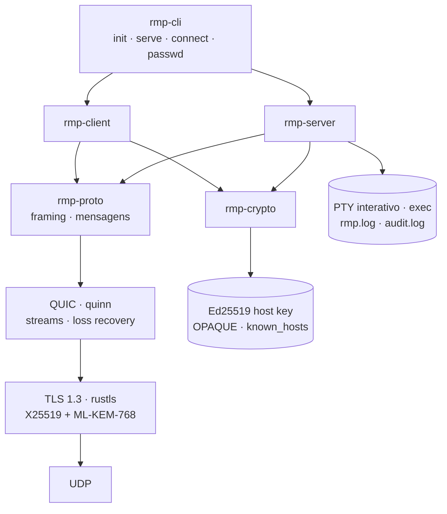
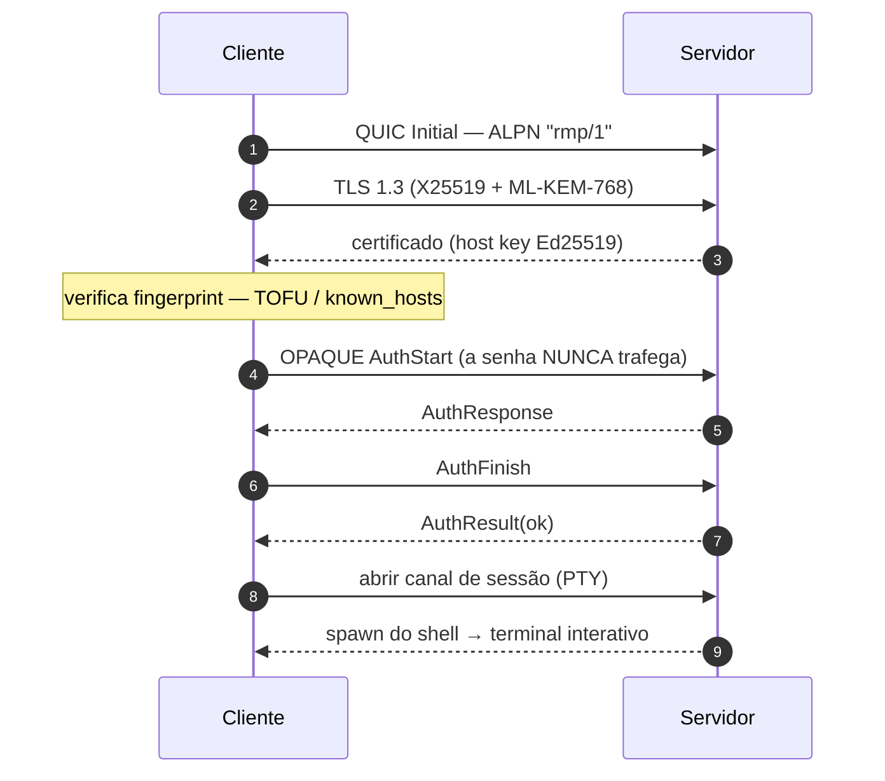

# RMP — Remote Machine Protocol

[](https://github.com/marcosgabrielgomes110-collab/rmp/actions/workflows/ci.yml)
[](https://github.com/marcosgabrielgomes110-collab/rmp/actions/workflows/audit.yml)
[](LICENSE)
[](rust-toolchain.toml)

**RMP** é um protocolo de acesso remoto por terminal — no estilo SSH — construído do
zero sobre **QUIC + TLS 1.3**. Você recebe um shell interativo (PTY) na máquina remota,
com segurança ligada por padrão, boa performance em redes ruins e configuração trivial.

> RMP **não usa SSH**: não faz túnel por SSH, não fala SSH2 e não depende do `sshd`. Ele
> reimplementa tudo numa base moderna.

## Propósito

- **Seguro por padrão** — nenhum texto claro na rede, autenticação resistente a ataques
  e verificação explícita da identidade do servidor.
- **Rápido e robusto** — multiplexação de streams, sem *head-of-line blocking*, e
  recuperação de perda de pacotes/congestionamento delegada ao QUIC.
- **Fácil de usar** — o setup pede uma senha; conectar é `rmp connect user@host`.
- **Multiplataforma** — Linux, macOS e Windows (servidor e cliente).

## Arquitetura



**Estabelecimento de conexão**



| Crate | Responsabilidade |
|---|---|
| `rmp-proto` | Wire protocol: framing, mensagens, codecs |
| `rmp-dirs` | Layout de arquivos (XDG / FHS) |
| `rmp-crypto` | TLS 1.3 + PQC, host keys, OPAQUE, `known_hosts` |
| `rmp-server` | Listener QUIC, autenticação, sessões PTY/exec, audit log |
| `rmp-client` | Transporte, autenticação, cliente interativo/exec |
| `rmp-cli` | O binário `rmp` |

## Segurança

| Proteção | Mecanismo |
|---|---|
| Confidencialidade/integridade | TLS 1.3 obrigatório, AEAD em cada pacote, sem downgrade |
| Forward secrecy | Chaves efêmeras por conexão |
| Resistência pós-quântica | Key exchange híbrido **X25519 + ML-KEM-768** (padrão) |
| Anti-MITM | Pinning de **fingerprint** (Ed25519, TOFU/`known_hosts`) |
| Senha nunca exposta | **OPAQUE (RFC 9807)**; servidor guarda registro resistente a ataque offline |
| Anti-brute-force | Rate limit + lockout por IP |
| Controle de acesso | Allow/deny por **CIDR** |
| Segredos em disco | Diretórios `0700`, arquivos `0600`, `zeroize` em memória |
| Auditoria | `audit.log` dedicado; comandos podem ser redigidos |
| Modo root | Fail-closed; rebaixa privilégio (`runuser`) para logins comuns |

Garantias, **não-garantias** e adversários em [`docs/threat-model.md`](docs/threat-model.md).

## Início rápido

```sh
# 1. No servidor: gera identidade e pede a senha de acesso
rmp init --user alice
#   config  ~/.config/rmp/config.toml
#   dados   ~/.local/share/rmp/{host_key.pem,opaque_setup.bin,password_file.bin}
#   estado  ~/.local/state/rmp/{rmp.log,audit.log}

# 2. No servidor: sobe o daemon
rmp serve

# 3. De outra máquina: conecta e abre o shell
rmp connect alice@host:2222
#   na 1ª vez mostra a fingerprint e pede confirmação (TOFU), depois a senha
```

Flags úteis:

```sh
rmp init --system            # /etc/rmp, /var/lib/rmp, /var/log/rmp
rmp init --root              # habilita login root (requer o serve rodando como root)
rmp passwd                   # troca a senha do usuário
rmp connect alice@host --accept-new
```

## Diretórios e logs

Separados por função (XDG para usuário, FHS para serviço); diretórios `0700`, segredos `0600`:

| Tipo | Usuário (XDG) | Sistema (`--system`) |
|---|---|---|
| Config (`config.toml`, `known_hosts`) | `~/.config/rmp` | `/etc/rmp` |
| Dados / **segredos** | `~/.local/share/rmp` | `/var/lib/rmp` |
| Estado / **logs** | `~/.local/state/rmp` | `/var/log/rmp` |

`rmp serve`/`connect` escrevem dois logs com rotação diária: **`rmp.log`** (tudo) e
**`audit.log`** (só eventos de segurança: `auth.success/failure/lockout`, `session.open/close`,
`connection.denied`, `host.trusted/mismatch`, …). Nenhum segredo é registrado.

## Configuração

O `rmp init` gera um `config.toml` **totalmente comentado** (veja
[`config.example.toml`](config.example.toml)). Principais seções: `[server]`, `[auth]`
(inclui `allow_root`), `[security]` (CIDR, timeouts), `[logging]`, `[client]`.

Para login como **root**: `rmp init --root` (ou `rmp passwd --root` + `allow_root = true`)
— e o `rmp serve` **precisa rodar como root**; caso contrário ele recusa iniciar.

## Documentação

- [`docs/architecture.md`](docs/architecture.md) — visão de sistema, handshake, ciclo de sessão, cross-platform.
- [`docs/protocol.md`](docs/protocol.md) — wire format versionado e mensagens.
- [`docs/threat-model.md`](docs/threat-model.md) — ativos, adversários, garantias e não-garantias.

## Desenvolvimento

```sh
make            # binário release (LTO + strip) em target/release/rmp
make test       # 41 testes (unit + integração end-to-end)
make clippy     # lint (warnings = erro)
make install    # instala em $(PREFIX)/bin
make dist       # empacota dist/rmp-<versão>-<os>-<arch>.tar.gz
```

Ou direto com o Cargo:

```sh
cargo test
cargo clippy --all-targets -- -D warnings
cargo fmt --all
```

## Licença

Licenciado sob a **MIT License** — © 2026 **Marcos Gomes**. Veja [`LICENSE`](LICENSE).

Contribuições: [`CONTRIBUTING.md`](CONTRIBUTING.md) · [`CODE_OF_CONDUCT.md`](CODE_OF_CONDUCT.md).
Vulnerabilidades: [`SECURITY.md`](SECURITY.md). Mudanças: [`CHANGELOG.md`](CHANGELOG.md).
